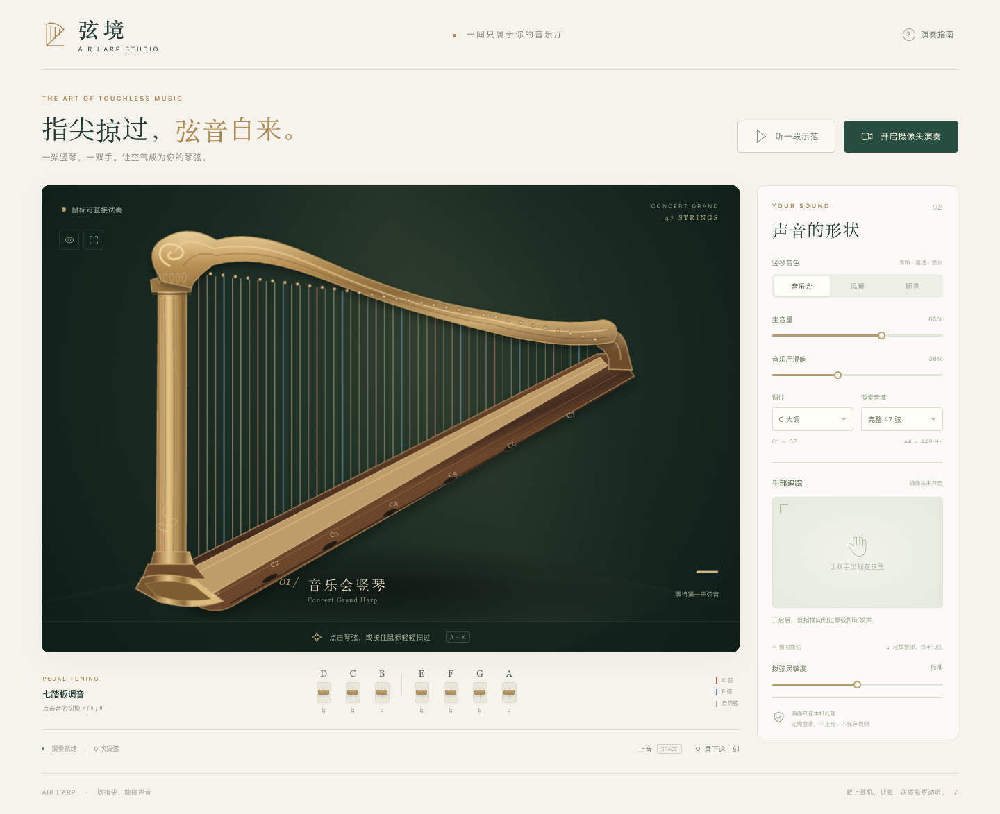

# 弦境 · AIR HARP STUDIO

用摄像头识别双手，以食指拨动琴弦的本地竖琴应用。无需账号，识别模型与声音合成都在设备上运行。



## 功能

- 音乐会竖琴外观，完整 47 弦（C1—G7）与常用 22 弦（C3—C6）两种音域。
- 双手食指拨弦、连续扫弦、琴弦振动与指尖光点反馈。
- 七踏板调音、调性切换与 A4 = 440 Hz 参考音高。
- 音乐会、温暖、明亮三种本地拨弦合成音色，带立体声混响与限幅。
- 鼠标、触屏和键盘试奏；演奏录音导出。
- 手部追踪与视频均在本机处理；内容安全策略阻止 SDK 的外部诊断连接。

音色采用物理拨弦合成，并非真实竖琴录音采样。踏板改变随后拨出的音符，不改变已经响起的弦音。

## 快速开始

需要 Python 3。推荐使用较新版本 Chrome 或 Safari。

```bash
git clone https://github.com/stevexyao/air-harp-studio.git
cd air-harp-studio
python3 server.py
```

浏览器会自动打开本地应用，默认地址为 `http://127.0.0.1:8768/`。如果端口被占用，启动器会顺次选择可用端口，请以终端实际输出为准。

macOS 也可双击仓库内的 `启动弦境竖琴.command`。如果下载 ZIP 后启动器没有执行权限，可运行：

```bash
chmod +x 启动弦境竖琴.command
```

运行应用无需 npm 安装或互联网连接。请通过本地服务打开，直接双击 `index.html` 无法正确加载摄像头与模型。

## 如何演奏

1. 戴上耳机，点击“开启摄像头演奏”，允许浏览器使用摄像头；不需要麦克风。
2. 在光线充足的地方伸出食指，横向划过舞台里的琴弦。两只手可以同时演奏。
3. 初次体验可切换“常用 22 弦”，弦间距更宽。调整灵敏度可减少漏音或误触。
4. 无摄像头时，直接点击琴弦，或按住鼠标拖动扫弦。

键盘 `A S D F G H J K` 对应 `C4 D4 E4 F4 G4 A4 B4 C5`，跟随当前踏板调音。`Space` 快速止音。

红弦标记 C，蓝弦标记 F。七踏板依次为 D、C、B ｜ E、F、G、A，可在还原、升半音和降半音之间切换。

点击“录下这一刻”开始，再次点击停止并保存。仅录制应用的乐器输出，文件为浏览器支持的 WebM 音频或 M4A。

更多操作与故障排查见 [使用说明](使用说明.md)。

## 开发与验证

应用为原生 JavaScript ES Modules、Canvas 2D、Web Audio 和本地 MediaPipe WASM，无构建步骤。Python 标准库提供仅监听 `127.0.0.1` 的静态服务。

核心测试仅需 Node.js：

```bash
npm test
```

浏览器集成测试需要可选的 Playwright 开发依赖，以及正在运行的本地服务：

```bash
npm install
npx playwright install chromium
# 在另一个终端运行 python3 server.py --no-open
npm run test:browser
npm run test:model
```

也可设置 `HARP_BROWSER_EXECUTABLE` 指定本机浏览器可执行文件，或通过 `HARP_BROWSER_CHANNEL` 选择浏览器渠道。`HARP_TEST_URL` 可指定其他本地端口。模型测试使用 Google 官方公开手部图像生成模拟视频流，不打开实体摄像头。

已验证核心逻辑、浏览器交互、录音有声输出、公开手部图像识别及模拟视频流。真实摄像头的使用体验取决于设备、光线与手势，尚未完成人体实测；Safari 和实体手机也尚未实测。

## 文件结构

```text
src/          界面交互、琴体绘制、声音引擎、追踪与碰弦逻辑
models/       本地手部识别模型
vendor/       MediaPipe JavaScript 与许可文本
wasm/         本地 WebAssembly 运行文件
fonts/        本地字体及 OFL 许可
tests/        核心与浏览器集成测试
预览/         应用截图与音色试听
server.py     本地服务
```

第三方资源说明见 [THIRD_PARTY_NOTICES.md](THIRD_PARTY_NOTICES.md)。
